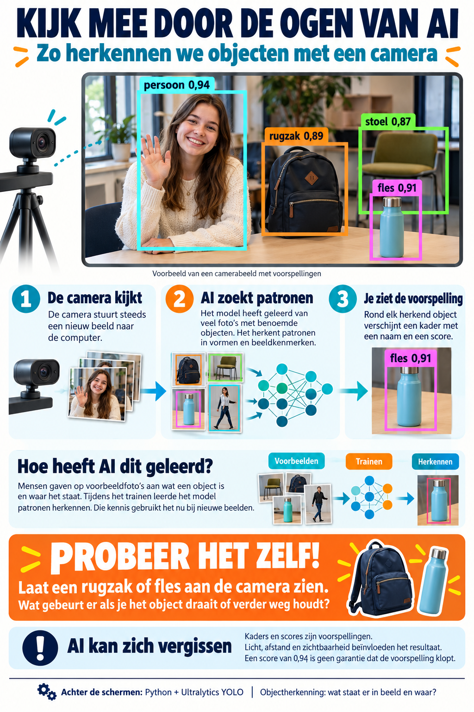

# AI-Camera

Realtime objectherkenning met de webcam, gebouwd op [Ultralytics YOLO](https://docs.ultralytics.com/).
Het programma opent een schermvullend dashboard:

- **links**: een infographic die uitlegt hoe de AI-camera werkt
- **rechts boven**: het live camerabeeld met de herkende objecten
- **rechts onder**: de uitvoer van Python / Ultralytics



## Vereisten

- Windows
- [Python 3.11](https://www.python.org/downloads/) (met de `py`-launcher, of `python` op het PATH)
- Een webcam

## Installeren

Dubbelklik op `setup.bat` of draai:

```bat
setup.bat
```

Dit maakt een virtualenv aan in `.venv` en installeert `ultralytics` (inclusief torch, OpenCV en Pillow) en `pygrabber`.
Je hoeft het YOLO-model niet zelf te downloaden. Ultralytics haalt `yolo26n.pt` automatisch op bij de eerste start.

## Starten

```bat
start-camera.bat
```

Sluiten met **Esc** (of Alt+F4). **F11** wisselt tussen schermvullend en venster.

## Instellingen

Pas de regel in `start-camera.bat` aan. De instellingen gebruiken de Ultralytics-notatie `key=value`:

```bat
.\.venv\Scripts\python.exe dashboard.py model=yolo26n.pt source=0 conf=0.25
```

| Instelling | Betekenis |
|---|---|
| `source=0` | Cameranummer. Je kunt ook een videobestand of RTSP-URL opgeven. |
| `model=yolo26n.pt` | Het model. `yolo26n` is snel, `yolo26s`/`m`/`l`/`x` zijn nauwkeuriger maar trager. |
| `conf=0.25` | Minimale zekerheid voordat een object wordt getoond. |
| `imgsz=640` | Beeldgrootte waarmee het model rekent. |
| `device=cpu` / `device=0` | Rekenen op de CPU of op de (NVIDIA-)GPU. |

### Welk cameranummer hoort bij welke camera?

```bat
.\.venv\Scripts\python.exe cameras.py
```

Dit toont alle beschikbare camera's met hun `source`-nummer, naam en resolutie.

## Projectstructuur

| Bestand | Inhoud |
|---|---|
| `setup.bat` | Maakt de venv aan en installeert de packages |
| `start-camera.bat` | Start het dashboard |
| `dashboard.py` | Het dashboard (Tkinter + OpenCV + Ultralytics) |
| `cameras.py` | Laat de beschikbare camera's zien |
| `AI-camera_infographic.png` | Infographic die in het dashboard wordt getoond |
